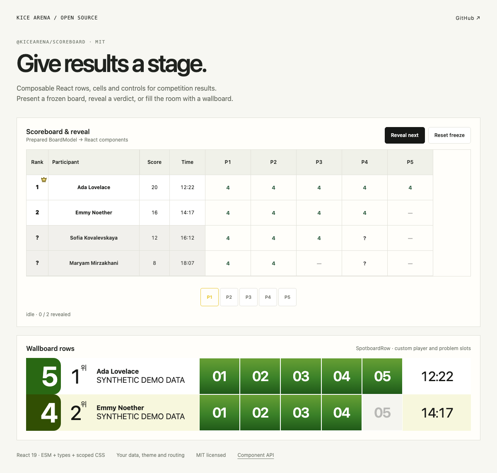

# @kicearena/scoreboard

Composable React components for scoreboards, frozen results and reveal presentation.

[](LICENSE)
[](https://www.npmjs.com/package/@kicearena/scoreboard)



## What can it do?

- **Rows & cells** — accepted, tried, empty and frozen states with first-solve presentation.
- **Reveal & wallboard** — prepared `BoardModel`, render slots and presentation animation hooks.
- **Controls & styling** — native buttons, problem navigation and scoped CSS; bring your own theme.

React 19 is a peer dependency. Scoring, rankings, routing and authorization belong to your application.

## Try the showcase

The [interactive demo](docs/demo.md) uses the real package with synthetic data. Clone this repository, then run:

```sh
bun install --frozen-lockfile
bun run demo
```

`bun run demo:build` creates a static site in `demo-dist/`. [Browse the editable example](demo/) or [read the API and integration guide](docs/api.md).

## Install

Install directly from the public npm registry:

```sh
npm install --save-exact @kicearena/scoreboard@0.1.3
# or
bun add --exact @kicearena/scoreboard@0.1.3
```

```tsx
import type { CSSProperties } from "react";
import {
  ScoreboardGrid,
  ScoreboardRow,
  ScoreboardCell,
} from "@kicearena/scoreboard";
import "@kicearena/scoreboard/styles.css";

// Render a prepared row; reveal layouts use BoardModel and render slots.
<ScoreboardGrid style={{ "--problem-count": 1 } as CSSProperties}>
  <ScoreboardRow>
    {["1", "Ada", "4", "2:05", "1 solved", "1 attempt"].map((text) => (
      <ScoreboardCell key={text}>{text}</ScoreboardCell>
    ))}
    <ScoreboardCell status="accepted" firstSolve>
      4
    </ScoreboardCell>
  </ScoreboardRow>
</ScoreboardGrid>;
```

Provide theme CSS variables as shown in the [integration guide](docs/api.md#테마와-css).

## Develop

```sh
bun run check
bun run test
bun run build
bun run demo:build
```

ESM and TypeScript declarations are included. 311 unit tests cover components, CSS cascade, reveal phases and scrolling. Release a new exact version with a matching `v<version>` tag; published tarballs are immutable.

## License

[MIT](LICENSE) © 2026 KICE Arena contributors. Dependencies retain their respective licenses.
